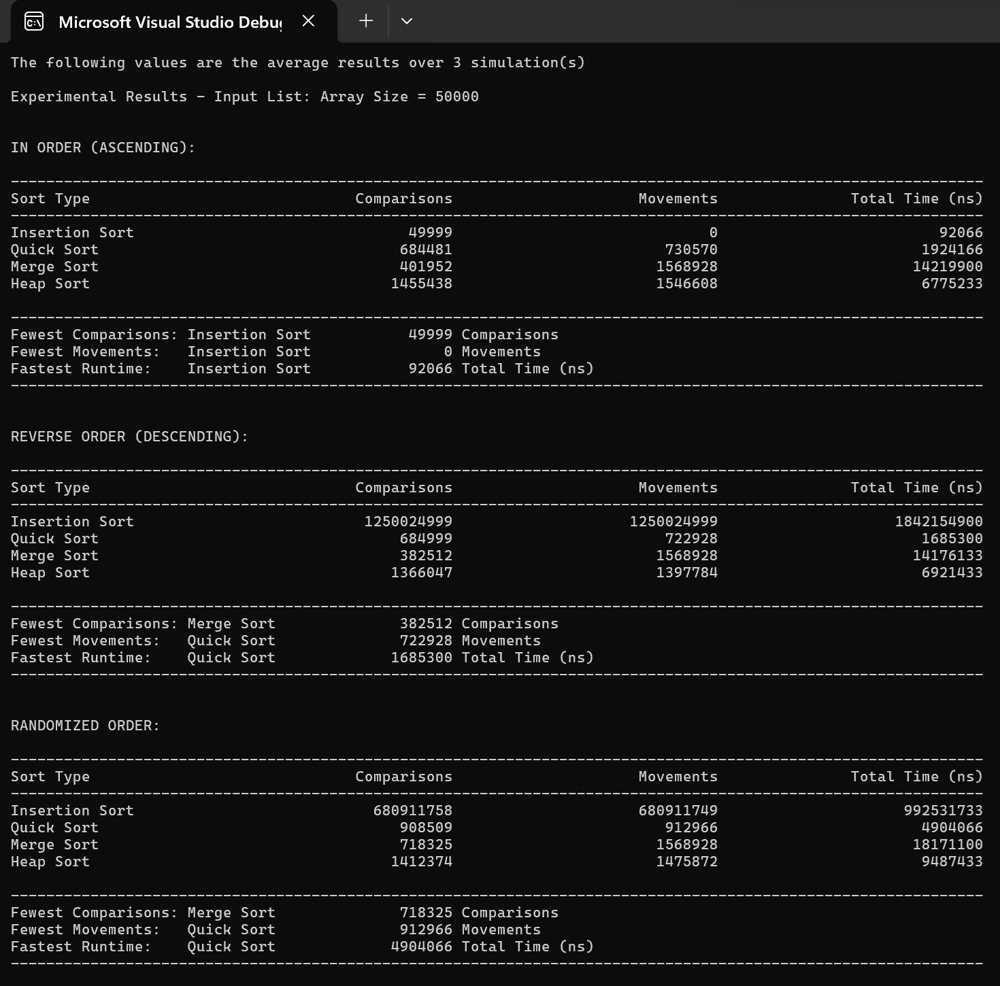

## Example output!



*Sample run: 50,000 elements per array, averaged over 3 runs. The program measures comparisons, element movements, and execution time, then highlights the best-performing algorithm for each metric.*

# Sorting Algorithms - Performance Comparison

A C++ console project that compares **Insertion Sort, Quick Sort, Merge Sort, and Heap Sort** to show how the starting order of data affects sorting performance! :)

## How it works

The program runs all four sorting algorithms against three types of input: **already sorted**, **reverse sorted**, and **randomized** arrays. It prints side-by-side results.

**What the screenshot shows:** Insertion Sort was fastest on the already-sorted data, while Quick Sort had the fastest runtimes for the reverse-sorted and randomized data in this example.

## Running the project

- **C++ compiler (g++):** From the repository folder, run:

  ```bash
  g++ -std=c++17 -O2 main.cpp 'C++SortingAlgorithms.cpp' -o sorting-benchmark
  ./sorting-benchmark
  ```

To change the benchmark, edit `TEST_ARRAY_SIZE` (default `50000`) or `TEST_ITERATIONS` (default `3`) near the top of `main.cpp`.

